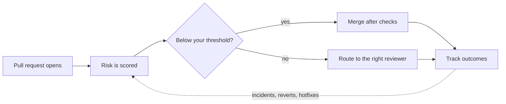

# Ephorate

**Review what needs a reviewer. Merge the rest on evidence.**

Ephorate gives every pull request a measured probability of causing a production incident, calibrated on your own history of changes and incidents. You set a threshold. Changes below it merge after automated checks; the rest go to the engineer who knows the code.

Website: https://YOUR-USERNAME.github.io/ephorate/

> **Status:** in development. The backtest engine is being built first. Nothing here is ready for production use yet. See [Status](#status).

## Why

AI coding agents have made writing code much faster. Reviewing it has not sped up, so review is now where work waits. A 2026 Harvard study of 655 firms estimated that coding agents raised lines of code by 44% while finished work rose 14%, and the time from review submission to approval grew 56%.

Many review tools now tag a change as low, medium or high risk by reading the diff. Ephorate does a different job: it produces a probability, checks that probability against what happened afterwards, and lets a team decide how much risk it will accept without a human review.

## How it works



1. **Learn from history.** Past changes are loaded and each incident, revert and hotfix is traced back to the change that caused it.
2. **Score each pull request.** Size, files touched, ownership and file history become a probability, calibrated so that 1% means 1%.
3. **Apply the policy.** A file in the repository sets the threshold and the paths that always need a person.
4. **Route the decision.** Below the threshold, the change merges once required checks pass. Above it, a reviewer familiar with the code is suggested.
5. **Track what happens.** Every merge is followed, and outcomes feed the next model refresh.

## What it looks like

A check on the pull request (example values):

| | |
|---|---|
| Incident risk for this change | 0.3% |
| Reviewed changes like it | 2.1% |
| Your threshold | 0.5% |
| Decision | Cleared to merge after checks |

A policy file in the repository:

```yaml
# .ephorate/policy.yml
threshold: 0.005          # 0.5% incident risk

always_review:
  - "services/payments/**"
  - "infra/terraform/**"
  - "**/migrations/**"

required_checks:
  - ci/tests
  - ai-review

mode: shadow              # report decisions without enforcing them
```

## Design rules

- **Read-only by default.** Ephorate reads history and incidents and writes one check. It does not merge, approve or push unless that is switched on.
- **Shadow mode first.** It starts by reporting what it would decide, so the decisions can be compared with outcomes before it gates anything.
- **The language model never decides.** A language model may tag a diff as one input. The decision comes from a calibrated statistical model plus the policy file, so every decision can be reproduced.
- **Source code is not stored.** Code is processed in memory to extract signals. Signals, file paths and commit identifiers are what is kept.

## Architecture

```
Sources                Core                          Surfaces
-------                ----                          --------
GitHub (PRs, commits)  Ingest and link incidents     Pull request check
CI results             Signal extraction             Reviewer routing in Slack
PagerDuty incidents    Calibrated risk model         Escape-rate dashboard
Datadog alerts         Policy engine                 Audit log
```

## Tech stack

| Layer | Choice |
|---|---|
| Backend | Python, FastAPI |
| Jobs and workflows | Temporal |
| State | PostgreSQL |
| Event analytics | ClickHouse |
| Code parsing | tree-sitter |
| Incident linking | SZZ-style blame tracing, revert and hotfix detection |
| Risk model | LightGBM with isotonic calibration |
| Policy | YAML file in the repository, GitHub Checks API |
| Dashboard | Next.js, TypeScript |
| Infrastructure | AWS, Terraform, Docker, GitHub Actions |

## Status

| Part | State |
|---|---|
| Backtest engine: history ingestion, incident linking, calibrated model, report | In development |
| GitHub App in shadow mode | Planned |
| Policy file and reviewer routing | Planned |
| Outcome tracking and dashboard | Planned |
| Deployment | Planned |

The backtest comes first on purpose. It answers one question on historical data: did the changes the model calls low risk really cause fewer problems? The live service is only worth building if the answer is yes.

## Repository

```
AGENTS.md           standing rules for coding agents working in this repo
PROJECT_PLAN.md     milestones, acceptance criteria and deployment plan
docs/               the website, served by GitHub Pages
notes/              decisions, backtest report and runbook
packages/           connectors, linking, signals, model, policy
services/           API and workers
apps/dashboard/     the dashboard
infra/terraform/    infrastructure
```

Setup and run commands are added with the first milestone. Until then, `PROJECT_PLAN.md` is the place to start.

## The name

The ephorate was Sparta's board of five elected overseers, who could hold even the kings to account. It is pronounced EFF-er-it.

## Reference

Chen, F. and Stratton, J. (2026). *Artificial Intelligence in the Firm: Bottlenecks in Software Production.* Harvard University.

## License

Not yet chosen.
